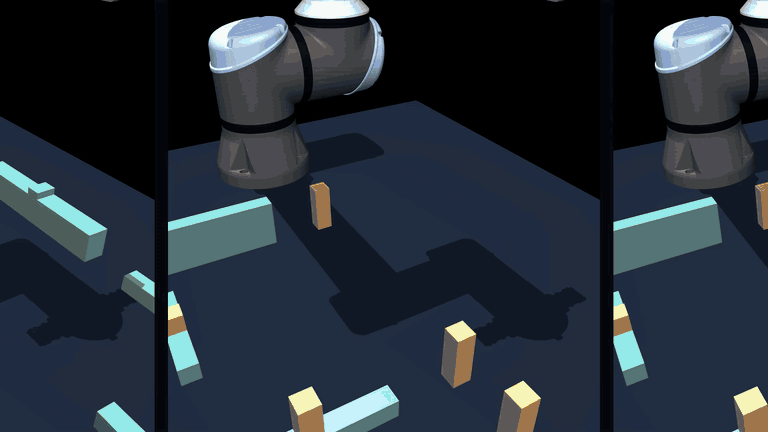
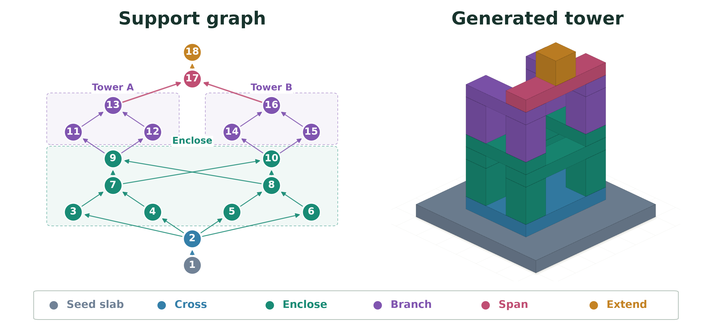

# Castle Reasoning

Castle Reasoning evaluates spatial reasoning through robot block assembly. An
agent chooses which parts to move and where to place them to reproduce a
target structure. The runtime plans and executes the robot motions, then checks the
assembled structure's poses, support contacts, and stability.

This package provides the task generator, pick-and-place planner, simulation
runtime, and tools for downloading existing benchmark tasks. The
[LLM evaluation harness](https://github.com/lianegalanti/castle-harness)
provides agent tools and episode evaluation.



## Dataset

The [published dataset](https://huggingface.co/datasets/alexmzhang/castle-reasoning/tree/0bf9ccdd51861eac5112280c6bbb601fdc3ca98c)
contains **1,648 accepted robot demonstrations of 1,072 distinct target
geometries**. Both campaigns are supported: 570 `S` targets and 502 `U`
targets. Task IDs select structures; repeated demonstrations share a task ID.

| Campaign | Targets with demonstrations | Accepted demonstrations / attempts |
| --- | ---: | ---: |
| [October 10](https://huggingface.co/datasets/alexmzhang/castle-reasoning/blob/0bf9ccdd51861eac5112280c6bbb601fdc3ca98c/campaign-1k-20261010/index.json) | 570 | 1,146 / 1,186 (96.6%) |
| [October 11](https://huggingface.co/datasets/alexmzhang/castle-reasoning/blob/0bf9ccdd51861eac5112280c6bbb601fdc3ca98c/campaign-tasks-20261011/index.json) | 502 | 502 / 527 (95.3%) |
| **Total** | **1,072** | **1,648 / 1,713 (96.2%)** |

Part counts range from **7 to 37**, with median **12**, mean **14.37**, and
middle 50% from **9 to 18**. Counting each target once:

| Parts | Targets | Share |
| --- | ---: | ---: |
| 7–12 | 567 | 52.9% |
| 14–24 | 421 | 39.3% |
| 28–37 | 84 | 7.8% |

- 57 targets (5.3%) keep one foundation part fixed; 1,015 have none fixed.
- 503 targets have one demonstration, 562 have two, and seven have three.
- The demonstrations contain 19,613,756 control actions at 50 Hz, about
  109 hours of simulated execution. Median duration is 3 minutes 22 seconds;
  the range is 1 minute 28 seconds to 10 minutes 49 seconds.

We generate these procedurally using a grammar which describes the center of
mass support structure of a proposed building.



## Quick start

Requirements: Linux x86_64 and [Pixi](https://pixi.sh/). Robot execution
requires an NVIDIA GPU; rendering requires EGL/OpenGL. Pixi installs Python
3.12 and the pinned dependencies.

The default evaluation uses the paper's nine-task benchmark, all from the
October 11 campaign (`campaign-tasks-20261011`):

| Difficulty | Parts | Task IDs |
| --- | --- | --- |
| Easy | 7 | `U0008`, `U0080`, `U0149` |
| Medium | 19–24 | `U0002`, `U0007`, `U0011` |
| Hard | 29–31 | `U0012`, `U0024`, `U0052` |

```sh
# Download the benchmark source.
git clone https://github.com/smbml/castle-reasoning-benchmark.git
# Enter the benchmark directory.
cd castle-reasoning-benchmark
# Install Python 3.12 and the locked runtime dependencies.
pixi install --locked
# Verify source/build hashes, compile a workcell, and take a native MuJoCo step.
# This installation check does not run a GPU episode.
pixi run --locked check-runtime
# Download the nine paper targets' plans, scenes, and recorded states into dataset/.
# Each target uses its first accepted demonstration in published index order.
pixi run --locked download-tasks --tasks U0008,U0080,U0149,U0002,U0007,U0011,U0012,U0024,U0052
```

Task data is stored in `dataset/` by default. Set `CASTLE_ROOT` or pass
`--root` to `download-tasks` to use another directory. The downloader creates
the directory, verifies the pinned inputs, and reuses verified files.

### Evaluate a model

Continue from the benchmark directory above. The harness installs the benchmark
and patched runtime from pinned Git dependencies and can reuse the task data
you just downloaded.

```sh
# Share the downloaded tasks with the harness.
export CASTLE_ROOT="$PWD/dataset"
# Download the evaluation harness alongside the benchmark.
git clone https://github.com/lianegalanti/castle-harness.git ../castle-harness
# Enter the harness directory.
cd ../castle-harness
# Use the tested harness revision with the pinned benchmark and Pixi runner.
git checkout bde21ab987fc7c96e2e2764f2d1997b992605441
# Install the harness's locked environment, including the patched runtime.
pixi install --locked
# Check that the installed runtime is intact and can take a native MuJoCo step.
pixi run --locked check-runtime
```

Run a model server separately, or use an existing OpenAI-compatible Chat
Completions endpoint with tool calling. Set its `/v1` URL, served model name,
and authentication key, then evaluate the nine-task benchmark:

```sh
# Replace this with your model endpoint's base URL.
export BASE_URL="http://127.0.0.1:8000/v1"
# Replace this with the model name accepted by that endpoint.
export MODEL="your-served-model"
# Use your endpoint's API key; unauthenticated local servers can use "local".
export OPENAI_API_KEY="local"
# Evaluate the default nine tasks with target coordinates and record each episode.
pixi run --locked run \
  --backend openai --base-url "$BASE_URL" --model "$MODEL" \
  --condition wipe --target-mode positions \
  --system-prompt prompts/system_level1.txt --device cuda:0 \
  --max-turns 60 --max-total-tokens 400000 \
  --max-sim-steps 200000 --max-wall-s 1800 \
  --record-trajectory --out runs/my-model-positions
# Inspect per-task pass/fail results, token counts, and failure reasons.
cat runs/my-model-positions/results.jsonl
```

Episode tool logs and recorded trajectories are in
`runs/my-model-positions/episodes/`. Use a new `--out` directory for each run.
Omitting `--tasks` runs all nine paper tasks; pass `--tasks U0008` for a single
task or `--tasks ID1,ID2` to select another set.

For target coordinates plus a worked example, set `--system-prompt` to
`prompts/system_level1_worked.txt`. For image-only evaluation, use
`--target-mode image --system-prompt prompts/system_image.txt` with a
vision-capable model endpoint. Download any additional task IDs with
`pixi run --locked download-tasks --tasks ID1,ID2` before evaluating them.

See [setup](docs/setup.md) for installation, task downloads, and harness
integration. [Tasks](docs/tasks.md) describes generation, artifact formats,
and success checks.

## Development

From the benchmark checkout:

```sh
pixi run --locked test
pixi run --locked build
```

The default tests cover seeded generation, static stability, plan preparation,
numerical regression contracts, packaging, and CPU execution/worker wiring.
GPU execution checks require separate opt-in and a working NVIDIA driver. See
[tasks](docs/tasks.md#generate-geometry-and-plans) for a local generation smoke
command and the distinction between geometry, prepared plans, and robot
execution.

Python APIs live under `src/castle_reasoning/`: `runtime/` contains simulation,
planning, control, execution, rendering, and diagnostics; `data/` contains
generation, assembly, and verification workflows. `third_party/` contains the
patched MuJoCo-Warp distribution. `scripts/` contains its two build helpers.
Tests live in `tests/` and usage documentation in `docs/`.

## License

Castle Reasoning's first-party code and documentation are [MIT licensed](LICENSE).
MuJoCo-Warp and other dependencies retain their own licenses; see
[third-party notices](THIRD_PARTY_NOTICES.md) and [runtime builds](docs/runtime-build.md).
